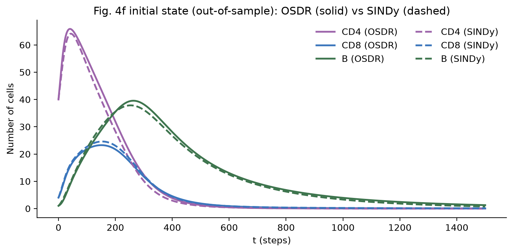
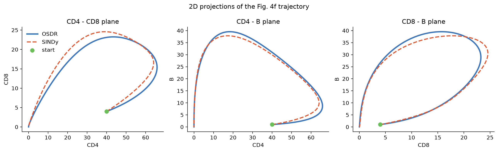
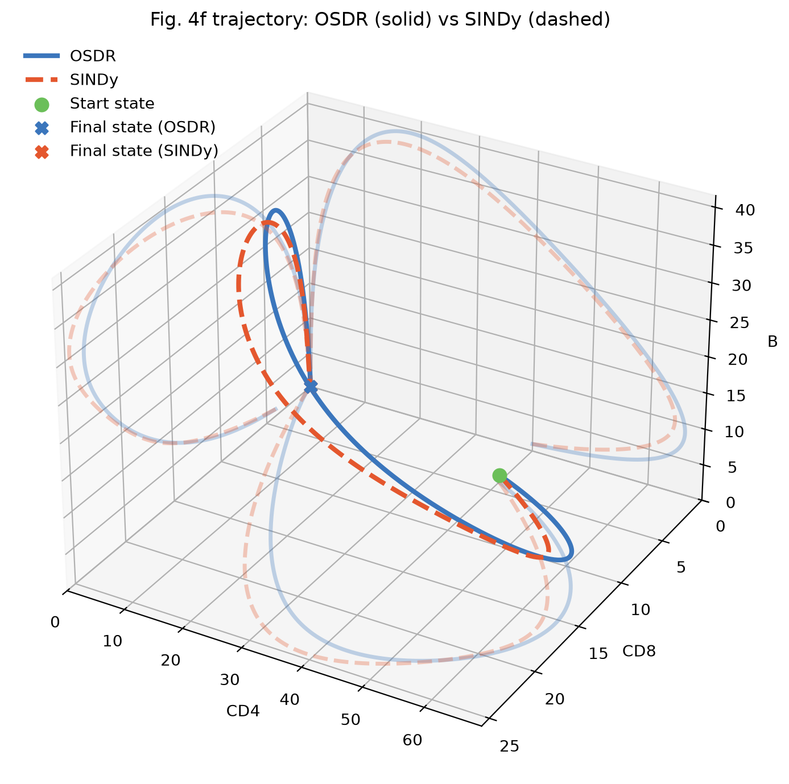

# OSDR ODE vs. SINDy ODE (Fig. 4f model)

Generated by `python project/part3_sindy.py --exp main` on 2026-10-28.

SINDy was trained on **98 time series** (from 100 observed neighbourhood compositions; trajectories that escaped were dropped), each of length **2000** sampled every **dt = 1**, generated by the OSDR ODE. Library: all monomials up to degree 3 (20 terms per equation); optimizer: STLSQ with threshold **0.0003** (chosen on held-out trajectories); states scaled by 1/50 during fitting.

## 1. The two models at a glance

|  | OSDR (ground truth) | SINDy (recovered) |
| --- | --- | --- |
| form | $X_i\,[\min(\sigma(\beta_i^\top\phi(X)),\,p_i^{\max}) - p_i^-]$ | $\sum_k \xi_{ik}\,\theta_k(X)$, sparse cubic polynomial |
| nonlinearity | sigmoid of a quadratic polynomial, times $X_i$ | polynomial (degree ≤ 3) |
| number of parameters | 36 (β: 30, p⁻: 3, p_max: 3) | 50 nonzero of 60 |
| estimated from | Ki67 + neighbour counts in one spatial snapshot (logistic regression) | simulated time series of the OSDR ODE (sparse regression) |
| $f(0)=0$ (no cells stay no cells) | always ($X_i$ multiplies every term) | only if constant terms are removed — here: yes |
| cell numbers stay ≥ 0 | always ($X_i = 0$ is invariant) | not guaranteed |
| per-cell growth rate | bounded: between −p⁻ and p_max − p⁻ | unbounded outside the training data |

## 2. The equations

### 2.1 OSDR (ground truth)

$\sigma(z) = 1/(1+e^{-z})$. Each $z$ is the logistic-regression score of the division probability.

$$
\begin{aligned}
\frac{d\mathrm{CD4}}{dt} &= \mathrm{CD4}\Big[\min\big(\sigma(z_{\mathrm{CD4}}),\ 0.0563\big) - 0.0172\Big] \\
z_{\mathrm{CD4}} &= -4.37 + 0.0655\,\mathrm{CD4} - 0.042\,\mathrm{CD8} - 0.038\,\mathrm{B} \\ &\quad - 6.92 \times 10^{-4}\,\mathrm{CD4}^{2} - 1.34 \times 10^{-4}\,\mathrm{CD4}\,\mathrm{CD8} - 6.79 \times 10^{-5}\,\mathrm{CD4}\,\mathrm{B} + 2.80 \times 10^{-4}\,\mathrm{CD8}^{2} \\ &\quad + 6.15 \times 10^{-4}\,\mathrm{CD8}\,\mathrm{B} + 1.57 \times 10^{-4}\,\mathrm{B}^{2}
\end{aligned}
$$

$$
\begin{aligned}
\frac{d\mathrm{CD8}}{dt} &= \mathrm{CD8}\Big[\min\big(\sigma(z_{\mathrm{CD8}}),\ 0.1412\big) - 0.0175\Big] \\
z_{\mathrm{CD8}} &= -4.05 + 0.068\,\mathrm{CD4} - 0.0409\,\mathrm{CD8} - 0.0366\,\mathrm{B} \\ &\quad - 6.41 \times 10^{-4}\,\mathrm{CD4}^{2} - 1.79 \times 10^{-4}\,\mathrm{CD4}\,\mathrm{CD8} - 3.48 \times 10^{-4}\,\mathrm{CD4}\,\mathrm{B} + 3.75 \times 10^{-4}\,\mathrm{CD8}^{2} \\ &\quad + 8.64 \times 10^{-4}\,\mathrm{CD8}\,\mathrm{B} + 1.44 \times 10^{-4}\,\mathrm{B}^{2}
\end{aligned}
$$

$$
\begin{aligned}
\frac{d\mathrm{B}}{dt} &= \mathrm{B}\Big[\min\big(\sigma(z_{\mathrm{B}}),\ 0.1207\big) - 0.0077\Big] \\
z_{\mathrm{B}} &= -5.14 + 0.0888\,\mathrm{CD4} + 0.0134\,\mathrm{CD8} - 0.0331\,\mathrm{B} \\ &\quad - 5.20 \times 10^{-4}\,\mathrm{CD4}^{2} - 1.54 \times 10^{-3}\,\mathrm{CD4}\,\mathrm{CD8} - 3.74 \times 10^{-4}\,\mathrm{CD4}\,\mathrm{B} + 3.29 \times 10^{-5}\,\mathrm{CD8}^{2} \\ &\quad + 6.69 \times 10^{-4}\,\mathrm{CD8}\,\mathrm{B} + 1.38 \times 10^{-4}\,\mathrm{B}^{2}
\end{aligned}
$$

### 2.2 SINDy (50 terms)

$$
\begin{aligned}
\frac{d\mathrm{CD4}}{dt} &= -2.46 \times 10^{-3}\,\mathrm{CD4} - 1.28 \times 10^{-3}\,\mathrm{CD8} + 1.29 \times 10^{-3}\,\mathrm{CD4}^{2} - 1.33 \times 10^{-3}\,\mathrm{CD4}\,\mathrm{CD8} \\ &\quad - 5.62 \times 10^{-4}\,\mathrm{CD4}\,\mathrm{B} + 2.31 \times 10^{-4}\,\mathrm{CD8}^{2} + 1.64 \times 10^{-4}\,\mathrm{CD8}\,\mathrm{B} - 1.33 \times 10^{-5}\,\mathrm{CD4}^{3} \\ &\quad - 1.59 \times 10^{-6}\,\mathrm{CD4}^{2}\,\mathrm{CD8} - 5.61 \times 10^{-6}\,\mathrm{CD4}^{2}\,\mathrm{B} + 1.30 \times 10^{-5}\,\mathrm{CD4}\,\mathrm{CD8}^{2} + 1.40 \times 10^{-5}\,\mathrm{CD4}\,\mathrm{CD8}\,\mathrm{B} \\ &\quad + 3.70 \times 10^{-6}\,\mathrm{CD4}\,\mathrm{B}^{2} - 2.95 \times 10^{-6}\,\mathrm{CD8}^{3} - 3.17 \times 10^{-6}\,\mathrm{CD8}^{2}\,\mathrm{B} - 1.61 \times 10^{-6}\,\mathrm{CD8}\,\mathrm{B}^{2}
\end{aligned}
$$

$$
\begin{aligned}
\frac{d\mathrm{CD8}}{dt} &= -9.04 \times 10^{-4}\,\mathrm{CD8} + 2.95 \times 10^{-4}\,\mathrm{CD4}^{2} + 6.93 \times 10^{-4}\,\mathrm{CD4}\,\mathrm{CD8} - 1.24 \times 10^{-4}\,\mathrm{CD4}\,\mathrm{B} \\ &\quad - 5.09 \times 10^{-4}\,\mathrm{CD8}^{2} - 3.60 \times 10^{-4}\,\mathrm{CD8}\,\mathrm{B} - 3.79 \times 10^{-6}\,\mathrm{CD4}^{3} - 5.65 \times 10^{-6}\,\mathrm{CD4}^{2}\,\mathrm{CD8} \\ &\quad - 1.33 \times 10^{-6}\,\mathrm{CD4}^{2}\,\mathrm{B} - 2.81 \times 10^{-6}\,\mathrm{CD4}\,\mathrm{CD8}^{2} - 4.82 \times 10^{-6}\,\mathrm{CD4}\,\mathrm{CD8}\,\mathrm{B} + 1.31 \times 10^{-6}\,\mathrm{CD4}\,\mathrm{B}^{2} \\ &\quad + 5.12 \times 10^{-6}\,\mathrm{CD8}^{3} + 9.99 \times 10^{-6}\,\mathrm{CD8}^{2}\,\mathrm{B} + 1.36 \times 10^{-6}\,\mathrm{CD8}\,\mathrm{B}^{2}
\end{aligned}
$$

$$
\begin{aligned}
\frac{d\mathrm{B}}{dt} &= -2.02 \times 10^{-3}\,\mathrm{CD4} + 8.90 \times 10^{-4}\,\mathrm{CD8} - 2.86 \times 10^{-3}\,\mathrm{B} + 1.23 \times 10^{-4}\,\mathrm{CD4}^{2} \\ &\quad + 2.65 \times 10^{-4}\,\mathrm{CD4}\,\mathrm{CD8} + 3.24 \times 10^{-4}\,\mathrm{CD4}\,\mathrm{B} - 8.41 \times 10^{-5}\,\mathrm{CD8}^{2} + 3.77 \times 10^{-5}\,\mathrm{CD8}\,\mathrm{B} \\ &\quad - 8.38 \times 10^{-5}\,\mathrm{B}^{2} - 3.10 \times 10^{-7}\,\mathrm{CD4}^{3} - 6.21 \times 10^{-6}\,\mathrm{CD4}^{2}\,\mathrm{CD8} + 4.81 \times 10^{-7}\,\mathrm{CD4}^{2}\,\mathrm{B} \\ &\quad - 1.34 \times 10^{-6}\,\mathrm{CD4}\,\mathrm{CD8}^{2} - 7.05 \times 10^{-6}\,\mathrm{CD4}\,\mathrm{CD8}\,\mathrm{B} - 2.74 \times 10^{-6}\,\mathrm{CD4}\,\mathrm{B}^{2} + 7.30 \times 10^{-7}\,\mathrm{CD8}^{3} \\ &\quad + 2.84 \times 10^{-6}\,\mathrm{CD8}^{2}\,\mathrm{B} + 1.81 \times 10^{-6}\,\mathrm{CD8}\,\mathrm{B}^{2} + 3.70 \times 10^{-7}\,\mathrm{B}^{3}
\end{aligned}
$$

### 2.3 Why the formulas cannot be compared term by term

OSDR is not a polynomial, so it has no 'true' cubic coefficients. To compare coefficients we use the **least-squares cubic approximation of the OSDR vector field** on the same training states (no sparsity): the best that a cubic polynomial can do, i.e. OSDR written in SINDy's language. Section 3 compares SINDy against it. Sections 4–6 compare SINDy against the OSDR ODE itself.

## 3. Coefficients: SINDy vs. the best cubic approximation of OSDR

Relative coefficient error (scaled units): **0.034**. Terms kept by SINDy: **50 / 60**.

*Scaled* coefficients are those of the model in units $X/50$, where every term is of order 1, so their sizes are comparable across terms (in cell units a cubic coefficient is tiny only because $X^3$ is huge). Rows are sorted by the size of the OSDR (LS cubic) coefficient.

<b>dCD4/dt</b> — 16 of 20 terms kept

| term | degree | OSDR (LS cubic), scaled | SINDy, scaled | OSDR (LS cubic), cell units | SINDy, cell units | status |
| --- | --- | --- | --- | --- | --- | --- |
| `CD4·CD8` | 2 | -0.0652 | -0.0666 | -1.305e-03 | -1.332e-03 | kept |
| `CD4^2` | 2 | +0.0647 | +0.0647 | +1.293e-03 | +1.294e-03 | kept |
| `CD4·CD8·B` | 3 | +0.0357 | +0.0350 | +1.427e-05 | +1.398e-05 | kept |
| `CD4^3` | 3 | -0.0330 | -0.0332 | -1.322e-05 | -1.326e-05 | kept |
| `CD4·CD8^2` | 3 | +0.0319 | +0.0325 | +1.277e-05 | +1.299e-05 | kept |
| `CD4·B` | 2 | -0.0300 | -0.0281 | -5.995e-04 | -5.622e-04 | kept |
| `CD4^2·B` | 3 | -0.0134 | -0.0140 | -5.361e-06 | -5.611e-06 | kept |
| `CD8^2` | 2 | +0.0117 | +0.0116 | +2.342e-04 | +2.312e-04 | kept |
| `CD4·B^2` | 3 | +0.0098 | +0.0092 | +3.931e-06 | +3.696e-06 | kept |
| `CD8·B` | 2 | +0.0087 | +0.0082 | +1.743e-04 | +1.638e-04 | kept |
| `CD8^2·B` | 3 | -0.0082 | -0.0079 | -3.278e-06 | -3.174e-06 | kept |
| `CD8^3` | 3 | -0.0076 | -0.0074 | -3.041e-06 | -2.948e-06 | kept |
| `CD4^2·CD8` | 3 | -0.0049 | -0.0040 | -1.940e-06 | -1.587e-06 | kept |
| `CD8·B^2` | 3 | -0.0044 | -0.0040 | -1.771e-06 | -1.606e-06 | kept |
| `CD4` | 1 | -0.0024 | -0.0025 | -2.439e-03 | -2.457e-03 | kept |
| `CD8` | 1 | -0.0014 | -0.0013 | -1.432e-03 | -1.283e-03 | kept |
| `B^2` | 2 | +0.0005 | 0 | +9.443e-06 | 0 | **removed by SINDy** |
| `B` | 1 | -0.0002 | 0 | -1.814e-04 | 0 | **removed by SINDy** |
| `B^3` | 3 | -0.0001 | 0 | -5.158e-08 | 0 | **removed by SINDy** |
| `1` | 0 | +0.0000 | 0 | +6.023e-04 | 0 | **removed by SINDy** |

<b>dCD8/dt</b> — 15 of 20 terms kept

| term | degree | OSDR (LS cubic), scaled | SINDy, scaled | OSDR (LS cubic), cell units | SINDy, cell units | status |
| --- | --- | --- | --- | --- | --- | --- |
| `CD4·CD8` | 2 | +0.0365 | +0.0347 | +7.295e-04 | +6.934e-04 | kept |
| `CD8^2` | 2 | -0.0258 | -0.0255 | -5.158e-04 | -5.090e-04 | kept |
| `CD8^2·B` | 3 | +0.0255 | +0.0250 | +1.020e-05 | +9.990e-06 | kept |
| `CD8·B` | 2 | -0.0182 | -0.0180 | -3.637e-04 | -3.596e-04 | kept |
| `CD4^2·CD8` | 3 | -0.0151 | -0.0141 | -6.042e-06 | -5.649e-06 | kept |
| `CD4^2` | 2 | +0.0148 | +0.0147 | +2.964e-04 | +2.950e-04 | kept |
| `CD8^3` | 3 | +0.0129 | +0.0128 | +5.152e-06 | +5.116e-06 | kept |
| `CD4·CD8·B` | 3 | -0.0117 | -0.0120 | -4.672e-06 | -4.820e-06 | kept |
| `CD4^3` | 3 | -0.0094 | -0.0095 | -3.762e-06 | -3.789e-06 | kept |
| `CD4·CD8^2` | 3 | -0.0079 | -0.0070 | -3.142e-06 | -2.812e-06 | kept |
| `CD4·B` | 2 | -0.0079 | -0.0062 | -1.570e-04 | -1.243e-04 | kept |
| `CD4·B^2` | 3 | +0.0039 | +0.0033 | +1.541e-06 | +1.315e-06 | kept |
| `CD8·B^2` | 3 | +0.0032 | +0.0034 | +1.296e-06 | +1.358e-06 | kept |
| `CD4^2·B` | 3 | -0.0028 | -0.0033 | -1.111e-06 | -1.327e-06 | kept |
| `CD8` | 1 | -0.0009 | -0.0009 | -8.641e-04 | -9.044e-04 | kept |
| `B^2` | 2 | +0.0004 | 0 | +7.206e-06 | 0 | **removed by SINDy** |
| `CD4` | 1 | -0.0001 | 0 | -1.266e-04 | 0 | **removed by SINDy** |
| `B^3` | 3 | -0.0001 | 0 | -4.378e-08 | 0 | **removed by SINDy** |
| `B` | 1 | -0.0001 | 0 | -5.577e-05 | 0 | **removed by SINDy** |
| `1` | 0 | +0.0000 | 0 | +1.945e-05 | 0 | **removed by SINDy** |

<b>dB/dt</b> — 19 of 20 terms kept

| term | degree | OSDR (LS cubic), scaled | SINDy, scaled | OSDR (LS cubic), cell units | SINDy, cell units | status |
| --- | --- | --- | --- | --- | --- | --- |
| `CD4·CD8·B` | 3 | -0.0173 | -0.0176 | -6.924e-06 | -7.053e-06 | kept |
| `CD4·B` | 2 | +0.0160 | +0.0162 | +3.204e-04 | +3.243e-04 | kept |
| `CD4^2·CD8` | 3 | -0.0154 | -0.0155 | -6.179e-06 | -6.212e-06 | kept |
| `CD4·CD8` | 2 | +0.0127 | +0.0133 | +2.536e-04 | +2.653e-04 | kept |
| `CD4·B^2` | 3 | -0.0068 | -0.0068 | -2.731e-06 | -2.736e-06 | kept |
| `CD8^2·B` | 3 | +0.0064 | +0.0071 | +2.541e-06 | +2.841e-06 | kept |
| `CD4^2` | 2 | +0.0059 | +0.0061 | +1.181e-04 | +1.227e-04 | kept |
| `CD8·B^2` | 3 | +0.0044 | +0.0045 | +1.749e-06 | +1.809e-06 | kept |
| `B^2` | 2 | -0.0041 | -0.0042 | -8.259e-05 | -8.375e-05 | kept |
| `CD8^2` | 2 | -0.0032 | -0.0042 | -6.482e-05 | -8.410e-05 | kept |
| `B` | 1 | -0.0029 | -0.0029 | -2.937e-03 | -2.858e-03 | kept |
| `CD4·CD8^2` | 3 | -0.0029 | -0.0034 | -1.148e-06 | -1.343e-06 | kept |
| `CD8·B` | 2 | +0.0025 | +0.0019 | +4.934e-05 | +3.765e-05 | kept |
| `CD4` | 1 | -0.0018 | -0.0020 | -1.803e-03 | -2.021e-03 | kept |
| `CD4^2·B` | 3 | +0.0013 | +0.0012 | +5.146e-07 | +4.805e-07 | kept |
| `CD8^3` | 3 | +0.0011 | +0.0018 | +4.476e-07 | +7.303e-07 | kept |
| `B^3` | 3 | +0.0009 | +0.0009 | +3.658e-07 | +3.696e-07 | kept |
| `CD4^3` | 3 | -0.0007 | -0.0008 | -2.657e-07 | -3.097e-07 | kept |
| `CD8` | 1 | +0.0006 | +0.0009 | +5.616e-04 | +8.901e-04 | kept |
| `1` | 0 | +0.0000 | 0 | +7.630e-04 | 0 | **removed by SINDy** |

## 4. Interactions: sign of the mean Jacobian $\partial f_i / \partial X_j$

Averaged over the observed neighbourhood compositions. **+** means that more cells of type *j* increase the growth of type *i*, **−** that they decrease it. Sign agreement: **7 / 9**.

| effect on ↓ of more → | **CD4** | **CD8** | **B** |
| --- | --- | --- | --- |
| **CD4** | + / + ✓ +0.0002 / +0.0007 | − / − ✓ -0.0065 / -0.0076 | − / − ✓ -0.0060 / -0.0039 |
| **CD8** | + / + ✓ +0.0062 / +0.0066 | + / − ✗ +0.0009 / -0.0027 | − / − ✓ -0.0026 / -0.0028 |
| **B** | + / + ✓ +0.0016 / +0.0007 | + / + ✓ +0.0039 / +0.0039 | + / − ✗ +0.0034 / -0.0007 |

(OSDR / SINDy)

## 5. Vector field and the origin

| region | relative error ‖f_SINDy − f_OSDR‖ / ‖f_OSDR‖ | median pointwise error | mean cosine |
| --- | --- | --- | --- |
| training trajectories | 0.105 | 0.283 | 0.965 |
| observed data states | 0.472 | 0.150 | 0.963 |
| beyond the data (> q99) | 0.808 | 0.805 | 0.724 |

| at the origin (no immune cells) | OSDR | SINDy |
| --- | --- | --- |
| f(0) | [-0. -0. -0.] | [0. 0. 0.] |
| eigenvalues of J(0) | [-0.00468 -0.00187 -0.00043] | [-0.00286 -0.00246 -0.0009 ] |
| origin stable? | yes | yes |

## 6. Behaviour

|  | OSDR | SINDy |
| --- | --- | --- |
| excitability threshold CD4(0) (CD8 = 4, B = 1) | 9.0 | 7.0 |
| CD4 peak (time) from (40, 4, 1) | 65.9 (t = 40) | 64.1 (t = 44) |
| CD8 peak (time) from (40, 4, 1) | 23.2 (t = 151) | 24.6 (t = 154) |
| B peak (time) from (40, 4, 1) | 39.5 (t = 263) | 37.8 (t = 254) |

Relative trajectory error from the Fig. 4f initial state (not used for training): **0.061**. Median error over 20 held-out initial states: **0.084** (0% escaped).

## 7. Threshold selection

| threshold | validation error | terms |  |
| --- | --- | --- | --- |
| 1e-05 | 0.1551 | 59 |  |
| 3e-05 | 0.1554 | 57 |  |
| 1e-04 | 0.1553 | 56 |  |
| 3e-04 | 0.1591 | 50 | **chosen** |
| 1e-03 | 0.2185 | 44 |  |
| 3e-03 | 0.5528 | 28 |  |
| 1e-02 | 0.5477 | 16 |  |

## 8. Figures

**Fig. 4f initial state: time series (solid OSDR, dashed SINDy)**

**2D projections of the Fig. 4f trajectory**

**3D trajectory: OSDR (solid) vs SINDy (dashed)**

